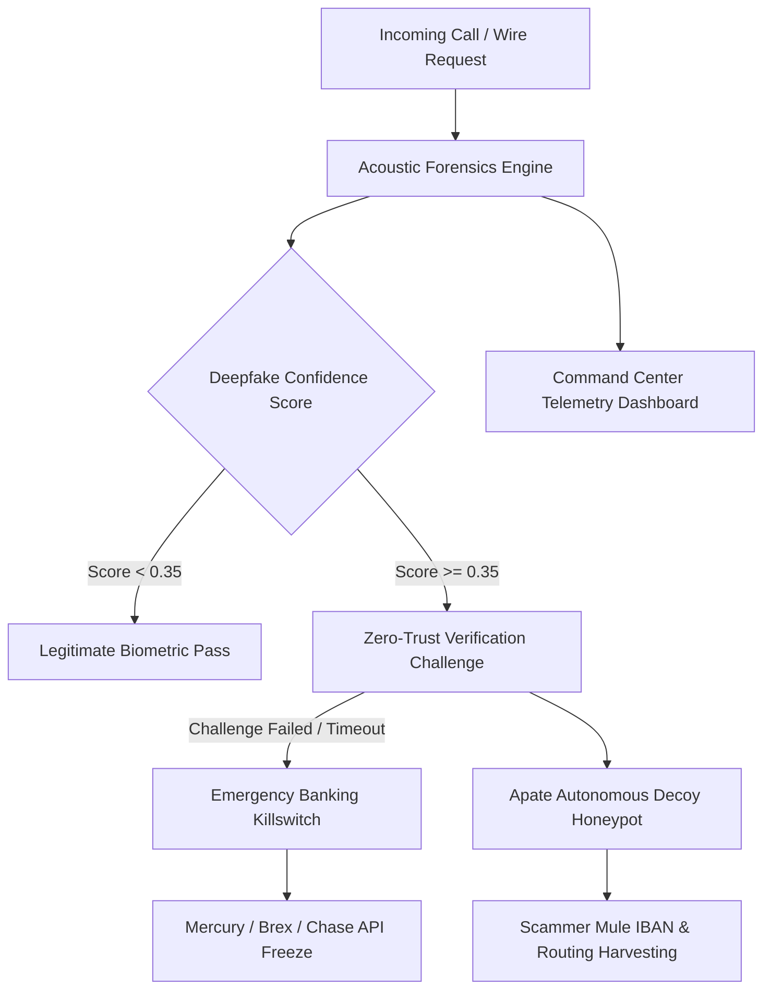

# FounderShield AI 🛡️⚡
### Zero-Trust Executive Voice & Wire Fraud Interception Platform

FounderShield AI is an institutional-grade security command center and active defense platform that intercepts incoming executive communications (voice calls, audio notes, wire instructions), subjects them to acoustic deepfake forensics and biometric analysis, triggers out-of-band cryptographic challenges, and diverts confirmed threat actors to autonomous decoy honeypots to harvest scammer mule IBANs and intelligence.

---

## 🌟 Key Capabilities

- **🎙️ Acoustic Forensics & Spectral Deepfake Voice Analyzer**:
  - Phase discontinuity detection, synthetic vocoder footprint identification, high-frequency harmonic cutoff analysis, and jitter/shimmer variance metrics.
- **🔐 Zero-Trust Executive Biometrics Registry**:
  - Strict Pydantic v2 schemas and Drizzle ORM models for C-suite biometric voiceprints, per-executive wire approval thresholds, and cryptographic handshake verification.
- **⚡ Autonomous Apate AI Decoy Honeypot**:
  - Diverts confirmed or suspected threat actors into automated conversational decoys to engage scammers, extract financial mule accounts, and neutralize wire fraud in real time.
- **🛑 Emergency Banking Killswitch Circuit Breaker**:
  - Immediate API-driven freeze and hold across Mercury, Brex, and Chase banking integrations.
- **📊 Palantir/CrowdStrike-Style Command Center**:
  - High-density telemetry dashboard built with Next.js 16, React, and Tailwind CSS.
- **🧪 60 Comprehensive Test Suites**:
  - 100% passing unit, integration, and adversarial stress tests validating deepfake thresholds, honeypot diversion, and banking circuit breakers.

---

## 🏗️ System Architecture



---

## 🚀 Quickstart & Local Deployment

### Ports
- **Frontend Command Center**: `http://localhost:3012`
- **FastAPI Forensics Backend**: `http://localhost:8012` (Swagger UI at `/docs`)

### Backend Setup (FastAPI & Python 3.12+)
```bash
cd backend
python -m venv .venv
source .venv/bin/activate
pip install fastapi uvicorn pydantic numpy scipy pytest httpx
uvicorn backend.main:app --host 0.0.0.0 --port 8012 --reload
```

### Run Backend Tests
```bash
pytest backend/test_main.py backend/test_adversarial.py -v
```

### Frontend Setup (Next.js 16)
```bash
cd frontend
npm install
npm run dev -- -p 3012
```

---

## 📁 Repository Structure

```
foundershield/
├── backend/
│   ├── analyzer.py          # Acoustic forensics & spectral deepfake detection algorithms
│   ├── main.py              # FastAPI application & REST/WebSocket routes
│   ├── store.py             # In-memory and persistence data stores
│   ├── test_adversarial.py  # Adversarial stress test suites
│   └── test_main.py         # Unit & functional test suites
├── db/
│   └── schema.ts            # Drizzle ORM relational schema specifications
├── frontend/
│   ├── src/
│   │   ├── app/             # Next.js 16 App Router pages & layout
│   │   ├── components/      # Radar, Spectrogram, Honeypot & Registry components
│   │   ├── lib/             # API client and telemetry utilities
│   │   └── types/           # UI TypeScript definitions
│   └── package.json
├── models/
│   └── schemas.py           # Pydantic v2 core schemas and validation contracts
├── types/
│   └── index.ts             # Shared TypeScript type definitions
└── schema.md                # Full ERD and relational specification
```

---

## 📜 License
MIT License. Developed for enterprise cybersecurity operations.
