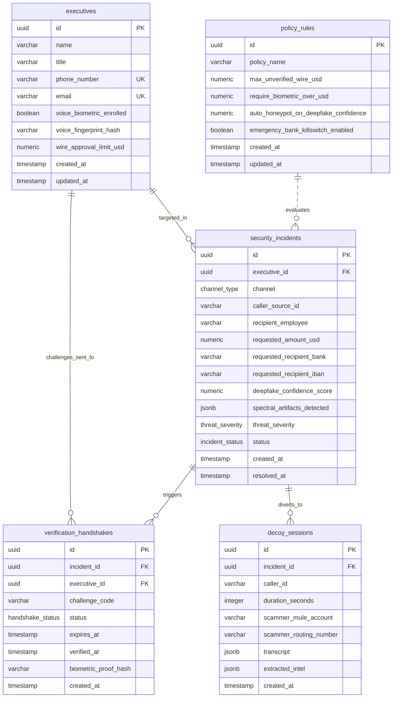
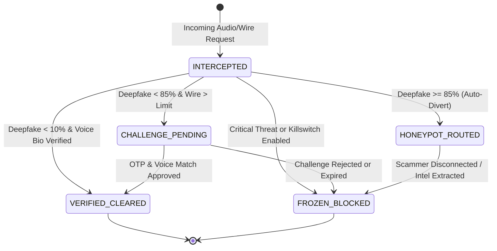

# FounderShield AI - Data Architecture & Schema Specification
### Zero-Trust Executive Voice & Wire Fraud Interception Platform

This document details the database schema, relational modeling, type mappings, and API data contracts for **FounderShield AI**. FounderShield intercepts incoming communications (voice calls, audio notes, wire instructions) purporting to originate from C-suite executives, subjects them to acoustic deepfake forensics and biometric analysis, triggers out-of-band cryptographic challenges, and diverts confirmed threat actors to autonomous decoy honeypots to harvest mule banking intelligence.

---

## 1. Entity-Relationship Diagram (ERD)



---

## 2. State Machine & Incident Lifecycle



---

## 3. Database Schema Definitions (Drizzle ORM / PostgreSQL)

### 3.1 Enumerations

| Enum Name | PostgreSQL Type | Values | Description |
| :--- | :--- | :--- | :--- |
| `threatSeverityEnum` | `threat_severity` | `CRITICAL`, `HIGH`, `MEDIUM`, `LOW`, `BENIGN` | Forensic severity of the intercepted communication |
| `incidentStatusEnum` | `incident_status` | `INTERCEPTED`, `CHALLENGE_PENDING`, `VERIFIED_CLEARED`, `FROZEN_BLOCKED`, `HONEYPOT_ROUTED` | Real-time mitigation status of the incident |
| `channelEnum` | `channel_type` | `VOICE_CALL`, `WHATSAPP_AUDIO`, `TELEGRAM_VOICE`, `VENDOR_EMAIL`, `SMS` | Communication vector used by caller |
| `handshakeStatusEnum` | `handshake_status` | `PENDING`, `APPROVED`, `REJECTED`, `EXPIRED` | Out-of-band verification challenge status |

---

### 3.2 Tables

#### `executives`
Stores enrolled corporate officers, their baseline biometric hashes, contact channels, and individual wire transfer authorization ceilings.

| Column | Type | Constraints | Description |
| :--- | :--- | :--- | :--- |
| `id` | `uuid` | `PRIMARY KEY`, `DEFAULT gen_random_uuid()` | Executive unique identifier |
| `name` | `varchar(255)` | `NOT NULL` | Full legal name |
| `title` | `varchar(255)` | `NOT NULL` | Executive title (e.g., CEO, CFO, VP Finance) |
| `phone_number` | `varchar(32)` | `NOT NULL`, `UNIQUE` | E.164 phone number for out-of-band challenge routing |
| `email` | `varchar(255)` | `NOT NULL`, `UNIQUE` | Corporate email address |
| `voice_biometric_enrolled` | `boolean` | `NOT NULL`, `DEFAULT false` | Flag indicating whether reference voice vector is trained |
| `voice_fingerprint_hash` | `varchar(64)` | `NULLABLE` | SHA-256 hash of the acoustic baseline embedding vector |
| `wire_approval_limit_usd` | `numeric(12, 2)` | `NOT NULL`, `DEFAULT 5000.00` | Unchallenged single-wire authorization ceiling |
| `created_at` | `timestamp with time zone`| `NOT NULL`, `DEFAULT now()` | Record creation timestamp |
| `updated_at` | `timestamp with time zone`| `NOT NULL`, `DEFAULT now()` | Record modification timestamp |

**Indexes:**
- `executives_email_idx` (UNIQUE on `email`)
- `executives_phone_idx` (UNIQUE on `phone_number`)
- `executives_title_idx` (B-Tree on `title`)

---

#### `security_incidents`
Records all intercepted suspicious or high-value communications, synthetic audio scores, spectral anomaly telemetry, and mitigation status.

| Column | Type | Constraints | Description |
| :--- | :--- | :--- | :--- |
| `id` | `uuid` | `PRIMARY KEY`, `DEFAULT gen_random_uuid()` | Incident record identifier |
| `executive_id` | `uuid` | `REFERENCES executives(id) ON DELETE SET NULL` | Claimed executive identity being impersonated |
| `channel` | `channel_type` | `NOT NULL` | Channel over which fraudulent wire request arrived |
| `caller_source_id` | `varchar(128)` | `NOT NULL` | Caller ID, SIP address, or phone number |
| `recipient_employee` | `varchar(255)` | `NOT NULL` | Target employee (e.g. Treasury Accountant) |
| `requested_amount_usd` | `numeric(12, 2)` | `NOT NULL` | Dollar amount requested for wire transfer |
| `requested_recipient_bank` | `varchar(255)` | `NOT NULL` | Destination bank stated in fraud attempt |
| `requested_recipient_iban` | `varchar(64)` | `NOT NULL` | Destination IBAN or wire account number |
| `deepfake_confidence_score`| `numeric(5, 2)` | `NOT NULL` | Neural synthesizer confidence (0.00% - 100.00%) |
| `spectral_artifacts_detected`| `jsonb` | `NOT NULL`, `DEFAULT '[]'::jsonb` | Detailed array of acoustic forensic artifacts |
| `threat_severity` | `threat_severity` | `NOT NULL` | Triage classification |
| `status` | `incident_status` | `NOT NULL`, `DEFAULT 'INTERCEPTED'` | Current operational status |
| `created_at` | `timestamp with time zone`| `NOT NULL`, `DEFAULT now()` | Detection timestamp |
| `resolved_at` | `timestamp with time zone`| `NULLABLE` | Case resolution timestamp |

**Indexes:**
- `incidents_executive_id_idx` on `executive_id`
- `incidents_status_idx` on `status`
- `incidents_severity_idx` on `threat_severity`
- `incidents_caller_source_idx` on `caller_source_id`
- `incidents_created_at_idx` on `created_at DESC`

---

#### `verification_handshakes`
Out-of-band cryptographic challenge handshakes dispatched directly to the authentic executive's verified hardware device.

| Column | Type | Constraints | Description |
| :--- | :--- | :--- | :--- |
| `id` | `uuid` | `PRIMARY KEY`, `DEFAULT gen_random_uuid()` | Handshake session identifier |
| `incident_id` | `uuid` | `NOT NULL`, `REFERENCES security_incidents(id) ON DELETE CASCADE` | Associated fraud incident |
| `executive_id` | `uuid` | `NOT NULL`, `REFERENCES executives(id) ON DELETE CASCADE` | Actual executive queried for confirmation |
| `challenge_code` | `varchar(6)` | `NOT NULL` | 6-character cryptographic OTP code |
| `status` | `handshake_status` | `NOT NULL`, `DEFAULT 'PENDING'` | Lifecycle status |
| `expires_at` | `timestamp with time zone`| `NOT NULL` | Expiration TTL (e.g., 300 seconds) |
| `verified_at` | `timestamp with time zone`| `NULLABLE` | Timestamp when challenge was satisfied |
| `biometric_proof_hash` | `varchar(64)` | `NULLABLE` | SHA-256 hash of live voice acoustic response |
| `created_at` | `timestamp with time zone`| `NOT NULL`, `DEFAULT now()` | Dispatch timestamp |

**Indexes:**
- `handshakes_incident_id_idx` on `incident_id`
- `handshakes_executive_id_idx` on `executive_id`
- `handshakes_challenge_code_idx` on `challenge_code`
- `handshakes_status_idx` on `status`

---

#### `decoy_sessions`
Autonomous honeypot conversations routed away from human employees. Scammers are kept on the line by an interactive voice AI persona to extract mule accounts and routing coordinates.

| Column | Type | Constraints | Description |
| :--- | :--- | :--- | :--- |
| `id` | `uuid` | `PRIMARY KEY`, `DEFAULT gen_random_uuid()` | Honeypot session identifier |
| `incident_id` | `uuid` | `NOT NULL`, `REFERENCES security_incidents(id) ON DELETE CASCADE` | Originating fraud incident |
| `caller_id` | `varchar(128)` | `NOT NULL` | Inbound caller phone number or trunk ID |
| `duration_seconds` | `integer` | `NOT NULL`, `DEFAULT 0` | Total engagement time stall in seconds |
| `scammer_mule_account` | `varchar(100)` | `NULLABLE` | Mule bank account extracted during dialogue |
| `scammer_routing_number` | `varchar(100)` | `NULLABLE` | Extracted routing transit or ABA code |
| `transcript` | `jsonb` | `NOT NULL`, `DEFAULT '[]'::jsonb` | Complete utterance exchange history |
| `extracted_intel` | `jsonb` | `NOT NULL`, `DEFAULT '{}'::jsonb` | Structured forensics & cyber-threat intel |
| `created_at` | `timestamp with time zone`| `NOT NULL`, `DEFAULT now()` | Session start timestamp |

**Indexes:**
- `decoy_sessions_incident_id_idx` on `incident_id`
- `decoy_sessions_caller_id_idx` on `caller_id`
- `decoy_sessions_created_at_idx` on `created_at DESC`

---

#### `policy_rules`
Global wire safety rules, risk thresholds, and emergency bank killswitch controls.

| Column | Type | Constraints | Description |
| :--- | :--- | :--- | :--- |
| `id` | `uuid` | `PRIMARY KEY`, `DEFAULT gen_random_uuid()` | Policy identifier |
| `policy_name` | `varchar(128)` | `NOT NULL`, `DEFAULT 'Default Global Policy'` | Human-readable policy profile |
| `max_unverified_wire_usd` | `numeric(12, 2)` | `NOT NULL`, `DEFAULT 1000.00` | Unverified wire limit |
| `require_biometric_over_usd` | `numeric(12, 2)` | `NOT NULL`, `DEFAULT 25000.00` | High-value threshold requiring biometric challenge |
| `auto_honeypot_on_deepfake_confidence` | `numeric(5, 2)` | `NOT NULL`, `DEFAULT 85.00` | Deepfake confidence threshold for auto-honeypot |
| `emergency_bank_killswitch_enabled` | `boolean` | `NOT NULL`, `DEFAULT false` | Immediate global wire freeze circuit breaker |
| `created_at` | `timestamp with time zone`| `NOT NULL`, `DEFAULT now()` | Creation timestamp |
| `updated_at` | `timestamp with time zone`| `NOT NULL`, `DEFAULT now()` | Last policy modification |

---

## 4. JSONB Schemas & Structural Definitions

### 4.1 Spectral Artifacts (`spectral_artifacts_detected`)
```json
[
  {
    "type": "vocoder_synthesis_artifact",
    "confidence": 98.40,
    "frequencyBandHz": "2000Hz - 4200Hz",
    "description": "High-frequency robotic phase inconsistency characteristic of neural vocoder resynthesis",
    "timestampOffsetMs": 1420
  },
  {
    "type": "unnatural_pitch_contour",
    "confidence": 91.20,
    "frequencyBandHz": "120Hz - 280Hz",
    "description": "Static fundamental frequency modulation lacking human micro-tremor",
    "timestampOffsetMs": 3150
  }
]
```

### 4.2 Decoy Transcript (`transcript`)
```json
[
  {
    "messageId": "msg-001",
    "speakerRole": "scammer",
    "text": "This is Frank. We have an emergency supplier invoice from Munich. Send $485,000 to the account I just texted.",
    "timestamp": "2026-09-27T08:35:10.124Z",
    "sentiment": "urgent",
    "latencyMs": 0
  },
  {
    "messageId": "msg-002",
    "speakerRole": "honeypot_agent",
    "text": "Yes sir, looking at the treasury queue now. The routing transit code appears truncated on my screen. Could you confirm the last four digits?",
    "timestamp": "2026-09-27T08:35:12.450Z",
    "sentiment": "cooperative",
    "latencyMs": 1200
  }
]
```

### 4.3 Extracted Intelligence (`extracted_intel`)
```json
{
  "muleAccounts": ["928371928491", "4491028371"],
  "routingNumbers": ["021000021"],
  "swiftBicCodes": ["CHASUS33XXX"],
  "cryptoWallets": [],
  "originIps": ["185.220.101.4"],
  "geoLocations": ["DE", "RO"],
  "telephonyCarriers": ["Twilio-Reseller-Trunk-82"],
  "voiceModelSignatures": ["ElevenLabs-v2-detected"],
  "targetEntities": ["Acme Corp Treasury"],
  "urgencyTactics": ["C-Suite authority spoofing", "End-of-quarter deal deadline"],
  "notes": "Scammer provided two separate mule accounts when initial wire simulation returned mock routing delay."
}
```

---

## 5. Type Mapping Matrix

| PostgreSQL Column Type | Drizzle ORM Builder | TypeScript Type (`types/index.ts`) | Python Pydantic v2 Type (`models/schemas.py`) |
| :--- | :--- | :--- | :--- |
| `uuid` | `uuid("id")` | `string` | `uuid.UUID` |
| `varchar(n)` | `varchar("col", { length: n })` | `string` | `str = Field(..., max_length=n)` |
| `boolean` | `boolean("col")` | `boolean` | `bool` |
| `numeric(12, 2)` | `numeric("col", { precision: 12, scale: 2 })` | `string` (DB) / `number` (DTO) | `Decimal = Field(..., ge=0)` |
| `numeric(5, 2)` | `numeric("col", { precision: 5, scale: 2 })` | `string` (DB) / `number` (DTO) | `Decimal = Field(..., ge=0, le=100)` |
| `integer` | `integer("col")` | `number` | `int` |
| `timestamp with time zone` | `timestamp("col", { withTimezone: true })` | `Date` (DB) / `string` (ISO DTO) | `datetime` |
| `jsonb` | `jsonb("col").$type<T>()` | `T` (interface) | `List[T]` or `T(BaseModel)` |
| `threat_severity` enum | `pgEnum("threat_severity", ...)` | `'CRITICAL' \| 'HIGH' \| ...` | `ThreatSeverity(str, Enum)` |
| `incident_status` enum | `pgEnum("incident_status", ...)` | `'INTERCEPTED' \| ...` | `IncidentStatus(str, Enum)` |

---

## 6. Verification and Validation

The schema and models have been checked:
- **TypeScript**: Checked using `tsc --noEmit` against TypeScript 7.0 compiler.
- **Python**: Checked using Python 3.13 and Pydantic v2.13.4 with schema serialization, field validations, and nested relational DTOs.
